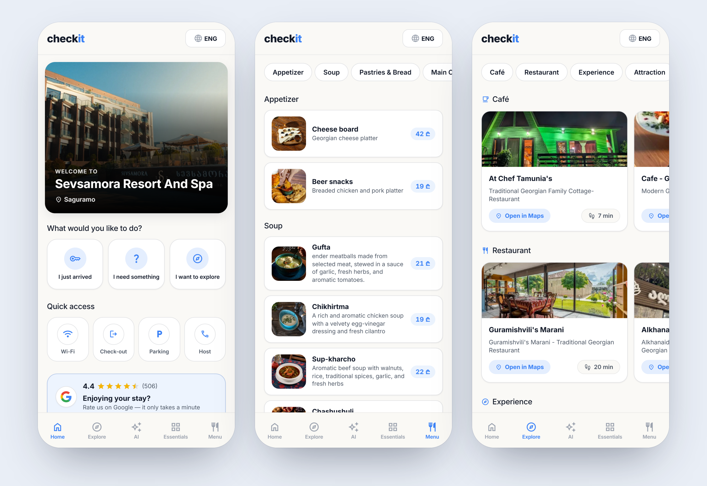
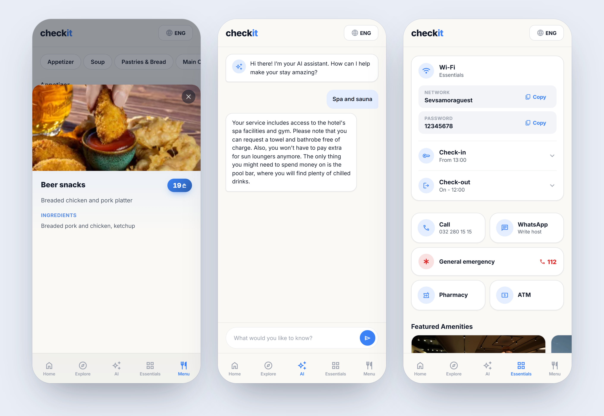
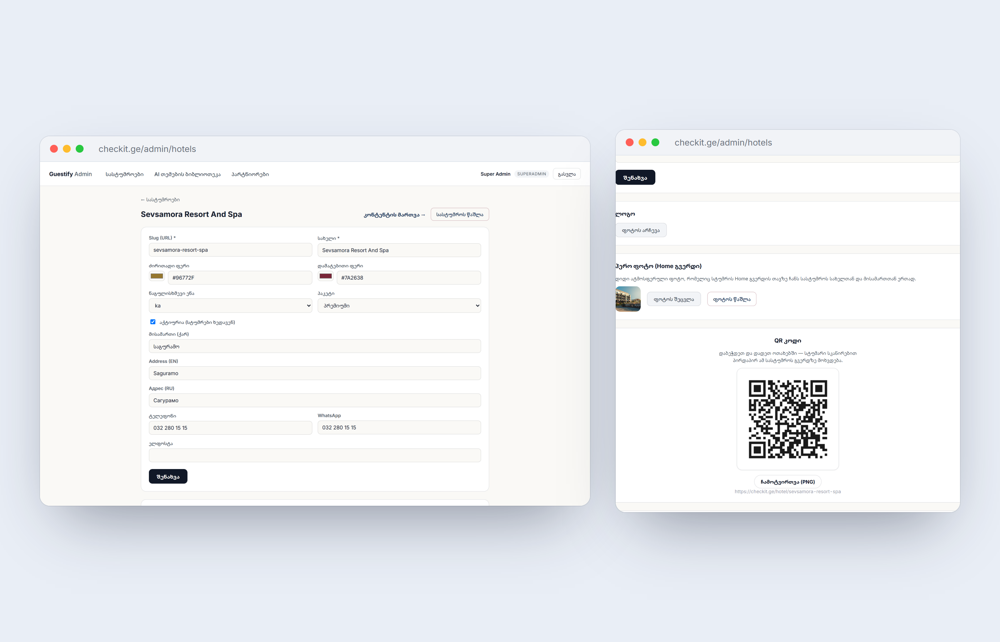

# Checkit (Guestify)

A QR concierge web app for hotels. Guests scan a QR code in their room and get the hotel on their phone: services, the restaurant menu, a local guide, a concierge chat and the everyday essentials (Wi-Fi, check-out, contacts). Nothing to install. Hotels manage all of it from an admin panel.

Live with a real hotel: **[checkit.ge/hotel/sevsamora-resort-spa](https://checkit.ge/hotel/sevsamora-resort-spa)**

`Guestify` is the codebase name; the product runs as **Checkit** on [checkit.ge](https://checkit.ge).



## Features

### Guest app (mobile first)

- **One link per hotel.** Every hotel opens at its own slug (`/hotel/<slug>`). Its name, photos, contacts and content load from the database.
- **Restaurant menu** with category filters, photos, prices and a detail sheet with ingredients.
- **Local guide**: cafés, restaurants and sights nearby, with walking or driving time and a link to Google Maps.
- **Concierge chat** that answers from topics the hotel defines (weighted keyword matching), offers suggested questions and points guests to the host when it isn't sure.
- **Essentials**: Wi-Fi network and password with copy buttons, check-in and check-out rules, call and WhatsApp the host, emergency number, nearest pharmacy and ATM.
- **Three languages** (Georgian, English, Russian) for the interface and the content. The choice is remembered.
- Skeleton loading states, a header that hides on scroll, View Transitions between tabs, and safe-area and `visualViewport` handling for iOS browsers.



### Admin panel

- **Two roles.** A superadmin manages every hotel. A hotel admin edits only their own hotel's content.
- Content editors for services, featured amenities, menu categories and dishes, the local guide, house rules, essentials and chat topics, each in three languages.
- **Drag-and-drop ordering** (Angular CDK) for menu categories, dishes, rules and services.
- Image uploads to Supabase Storage.
- A **printable QR code** for each hotel, generated in the browser and downloadable as PNG.
- A shared library of chat topic templates that hotels can start from.



## Tech stack

| Layer | Tools |
| --- | --- |
| Frontend | Angular 19 (standalone components, signals, lazy-loaded routes, resolvers and guards), TypeScript, SCSS, Angular CDK |
| Backend | Supabase: PostgreSQL, Auth, Storage |
| Security | Row Level Security policies: guests read only active hotels, and each admin writes only to their own hotel |
| Hosting | Netlify (SPA fallback in `web/public/_redirects`) |

## How it works

- **White-label by slug.** One codebase serves every hotel. A route resolver loads the hotel by its slug and caches it, so switching tabs doesn't refetch it.
- **The database enforces access.** The publishable Supabase key ships to the browser, so permissions live in RLS policies (`supabase/migrations`), not in the client. Helper functions such as `is_superadmin()` and `is_hotel_admin_of(hotel_id)` keep the policies short.
- **Content is translated per field** (`title_ka`, `title_en`, `title_ru`, and so on). A `localize` pipe picks the right one and falls back to Georgian.

## Project structure

```
supabase/
  migrations/        # schema, RLS policies and storage, applied in order (0001 to 0022)
  seed.sql           # a demo hotel with sample content
web/                 # Angular app
  src/app/
    core/            # services (Supabase, auth, hotel context), guards, resolvers, i18n, models
    features/
      guest/         # guest shell, home, menu, guide, concierge chat, essentials
      admin/         # login, hotels, content editors, chat topic templates
      landing/       # checkit.ge landing page
    shared/          # cards, sheets, icon, QR code, language switcher, directives
```

## Running locally

Requirements: Node 20+ and a Supabase project.

1. Run the SQL files in `supabase/migrations` in order (SQL Editor or `supabase db push`). Then run `supabase/seed.sql` for a demo hotel at `/hotel/aurahotel`.
2. Put your project URL and publishable key in `web/src/environments/environment.development.ts`.
3. Start the app:

```bash
cd web
npm install
npm start
```

The app runs at `http://localhost:4200`. To get a superadmin, sign up a user in Supabase Auth and set `role = 'superadmin'` on their row in `public.profiles`.

Production build: `npm run build` (output in `web/dist/web/browser`).
